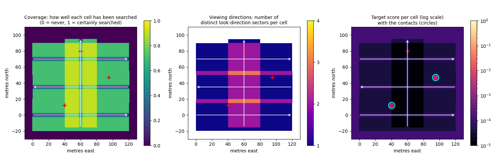

# BlueBoat-Belief

The belief map of the BlueBoat side-scan sonar survey. It takes every processed sonar ping and every
detector output, and keeps a running estimate of three things: **where targets probably are**,
**where the seabed has really been searched**, and **from which directions** it has been searched.
It publishes that estimate as one message, `BeliefGrid`, which the Replanner reads.



*An illustration made with Belief's own core on a synthetic survey (three east-west passes and one
north-south pass, white arrows; three objects, red crosses). Left: how well each cell has been
searched. Middle: from how many distinct directions each cell has been seen; the cross pass adds a
second direction. Right: the target score, with the two contacts the detections created (circles).
The third object was never detected, so its cell only got "searched, nothing found" evidence. The
numbers come from placeholder detector settings: this is not a real run.*

> **The scores are not probabilities yet.** No detector is trained, and the detector's
> calibration is not done. Belief runs with `detector.calibrated: false` and says so in every grid.
> With the dummy detector of BlueBoat-Perception, Belief reports zero coverage, which is correct:
> the dummy searches nothing.

## What you can do with it

- **Build the belief map live** from the sonar processor, the detector, the boat's position and GPS.
- **See where you have searched, and from which directions**, on two display maps and a contact list
  (for example in RViz).
- **Ask what is around a point**: a service sums the belief inside a disc.
- **Replay a recorded run offline** and get a byte-identical result.
- **Drive the core from Python without ROS**, for evaluation loops (the Replanner's development loop
  does this).
- **Make a survey-area file** for a real-boat run from GPS corners, a simulated world or a Replanner
  mission.

How it works, in short:

- **A miss is evidence.** A look that finds nothing makes a target there less likely.
- **Only where the detector searched.** A ping the detector never processed counts for nothing.
- **Looks, not pings.** The many pings of one pass over a cell form one look.
- **Directions matter.** Two parallel looks add little; a perpendicular one adds a lot
  (Paull et al. 2013).
- **Turns.** The inner side of a turn is scanned backwards and distorted, so it is ignored.

## How it connects to the other modules

```
sonar ──► Perception ──► [ Belief ] ──BeliefGrid──► Replanner ──► Control
```

| Module | Link | Relation to Belief |
|---|---|---|
| BlueBoat-SSS | [github.com/Kyyrron/BlueBoat-SSS](https://github.com/Kyyrron/BlueBoat-SSS) | Its processor sends every ping (`/sss_processor/processed`) |
| BlueBoat-Perception | [github.com/Kyyrron/BlueBoat-Perception](https://github.com/Kyyrron/BlueBoat-Perception) | Sends the detections, and one record per image saying what was searched |
| BlueBoat-Replanner | [github.com/Kyyrron/BlueBoat-Replanner](https://github.com/Kyyrron/BlueBoat-Replanner) | Reads `BeliefGrid` as its only target evidence |
| BlueBoat-Control | [github.com/Kyyrron/BlueBoat-Control](https://github.com/Kyyrron/BlueBoat-Control) | Provides the boat's position and the sonar message types |
| BlueBoat-SSS-Sim | [github.com/Kyyrron/BlueBoat-SSS-Sim](https://github.com/Kyyrron/BlueBoat-SSS-Sim) | A simulated world folder can serve as the survey area |
| Whole project | [github.com/Kyyrron/BlueBoat-SideScanSonar](https://github.com/Kyyrron/BlueBoat-SideScanSonar) | The superproject that holds every module |

Belief does not plan, and the Replanner does not fuse detections. Like all project software, Belief
runs on the operator laptop.

## Dependencies

| Dependency | Link | Quick install |
|---|---|---|
| Ubuntu 24.04, ROS 2 Jazzy | [docs.ros.org](https://docs.ros.org/en/jazzy/Installation/Ubuntu-Install-Debs.html) | `sudo apt install ros-jazzy-desktop` |
| `blueboat_interfaces` | [BlueBoat-Control](https://github.com/Kyyrron/BlueBoat-Control) | built in the same workspace |
| ROS message packages | apt | `sudo apt install ros-jazzy-vision-msgs ros-jazzy-diagnostic-msgs ros-jazzy-visualization-msgs` |
| numpy, PyYAML | | `sudo apt install python3-numpy python3-yaml` |
| `rosbags`, for the offline replay only | [pypi.org/project/rosbags](https://pypi.org/project/rosbags/) | in the workspace venv: `pip install rosbags` |

## Installation, step by step

```bash
# 1. Get the project with its submodules (or clone https://github.com/Kyyrron/BlueBoat-Belief alone)
mkdir -p ~/ros2_ws/src && cd ~/ros2_ws/src
git clone --recurse-submodules https://github.com/Kyyrron/BlueBoat-SideScanSonar.git

# 2. ROS packages
sudo apt install ros-jazzy-vision-msgs ros-jazzy-diagnostic-msgs ros-jazzy-visualization-msgs

# 3. Build, from a terminal that has NOT activated the venv
cd ~/ros2_ws && source /opt/ros/jazzy/setup.bash
colcon build --packages-select blueboat_interfaces                     # first, if not built yet
colcon build --packages-select blueboat_belief_interfaces blueboat_belief

# 4. Every new terminal
cd ~/ros2_ws && source env.sh       # env.sh: "source .venv/bin/activate" + "source install/setup.bash"
```

`blueboat_belief_interfaces` (the `BeliefGrid` message) must be built before `blueboat_belief`.

## Check the installation

```bash
# 1. The offline test gate (no ROS; do not source the workspace first)
cd ~/ros2_ws/src/BlueBoat-SideScanSonar/BlueBoat-Belief/blueboat_belief
test/gate.sh                         # must end with ALL CHECKS PASSED, in both Python environments

# 2. The node starts on a world or an area file
cd ~/ros2_ws && source env.sh
ros2 launch blueboat_belief belief_launch.py area_file:=<world folder | survey-area yaml>
# in another terminal: the grid's sequence number
ros2 topic echo --once /belief_map/belief_grid --qos-durability transient_local --field grid_seq
```

## Tips: when to use it, what to know

- **Run it whenever the Replanner runs**: the Replanner reads nothing else about targets.
- **Use `use_sim_time:=true` in Gazebo** and `false` on the real boat.
- **Wait for `odom_to_map_valid: true`** in the grid before planning: until the GPS and odometry are
  aligned, the map frame is not known.
- **Record Belief's inputs** (`record_inputs:=true`) on any run you may want to replay offline.
- **The detector settings (detection and false-alarm rates, prior density) are placeholders** until
  they are fitted on a real detector. Never tune a number to improve a result.
- **Belief never reads simulation ground truth.**
- **Nothing is overwritten**: snapshots go to `<root>/data/Belief_data/<run>/`.

## More documentation

| Document | What you find there |
|---|---|
| [blueboat_belief/docs/USER_GUIDE.md](blueboat_belief/docs/USER_GUIDE.md) | Running, the survey-area file, the replay, topics, settings, outputs |
| [blueboat_belief/docs/DEVELOPMENT.md](blueboat_belief/docs/DEVELOPMENT.md) | How to work on Belief: Claude Code, setup, tests, rules, next steps |
| [blueboat_belief/docs/MATH.md](blueboat_belief/docs/MATH.md) | The model, equation by equation |
| [blueboat_belief/docs/topics.md](blueboat_belief/docs/topics.md) | The interface contract: topics, delivery settings, frames, every field |
| [blueboat_belief/docs/DESIGN.md](blueboat_belief/docs/DESIGN.md) | Design decisions, limitations, scientific status, open decisions |
| [blueboat_belief/docs/OFFLINE_CORE_API.md](blueboat_belief/docs/OFFLINE_CORE_API.md) | Using the core without ROS |
| [blueboat_belief/docs/SURVEY_AREA_FORMAT.md](blueboat_belief/docs/SURVEY_AREA_FORMAT.md) | The survey-area file |
| [blueboat_belief/docs/VALIDATION_REPORT.md](blueboat_belief/docs/VALIDATION_REPORT.md) | What was run, with commands and results |
| [blueboat_belief/docs/REFERENCES.md](blueboat_belief/docs/REFERENCES.md) | Sources and what each supports |
| [blueboat_belief/docs/REQUESTS.md](blueboat_belief/docs/REQUESTS.md) | What Belief needs from other modules |
| [blueboat_belief/docs/BELIEF_BRIEF.md](blueboat_belief/docs/BELIEF_BRIEF.md) | The original design brief |

Main references: Bourgault, Furukawa & Durrant-Whyte (2006); Paull, Saeedi, Seto & Li (2013);
Yordanova & Gips (2020).

Licence: Apache-2.0.
